# Dokumentasi Sistem AKSMA Device Tracker

| | |
|---|---|
| **Nama sistem** | AKSMA Device Tracker (bagian dari AKSMA DIGITAL HUB) |
| **Konteks** | Program PLP Manajemen Pendidikan Islam, SMA IT Akmala Sabila |
| **Jenis dokumen** | Dokumentasi sistem: kebutuhan, perancangan, dan pengoperasian |
| **Versi dokumen** | 1.0 (Oktober 2026) |
| **Pembaca** | Pengelola sekolah dan petugas (bagian 1 sampai 3), pengembang (bagian 4 sampai 11) |

> Diagram di dokumen ini ditulis dengan [Mermaid](https://mermaid.js.org/) sehingga tampil otomatis di GitHub. Jika diagram tidak tampil di aplikasi lain, salin kodenya ke <https://mermaid.live>.

## Daftar isi
1. [Gambaran umum (untuk semua pembaca)](#1-gambaran-umum-untuk-semua-pembaca)
2. [Aktor dan hak akses](#2-aktor-dan-hak-akses)
3. [Panduan singkat penggunaan](#3-panduan-singkat-penggunaan)
4. [Kebutuhan sistem](#4-kebutuhan-sistem)
5. [Use case diagram](#5-use-case-diagram)
6. [Activity diagram](#6-activity-diagram)
7. [Status perangkat (state diagram)](#7-status-perangkat-state-diagram)
8. [Sequence diagram](#8-sequence-diagram)
9. [Arsitektur dan deployment](#9-arsitektur-dan-deployment)
10. [Perancangan data (ERD dan kamus data)](#10-perancangan-data-erd-dan-kamus-data)
11. [Aturan bisnis, API, dan keamanan](#11-aturan-bisnis-api-dan-keamanan)
12. [Skenario pengujian](#12-skenario-pengujian)
13. [Batasan dan pengembangan lanjutan](#13-batasan-dan-pengembangan-lanjutan)
14. [Glosarium](#14-glosarium)

---

## 1. Gambaran umum (untuk semua pembaca)

### 1.1 Masalah yang diselesaikan
Sekolah memiliki laptop dan tablet yang dipinjam siswa. Bila pencatatannya manual, sering terjadi: tidak tahu siapa yang sedang meminjam, perangkat terlambat kembali tanpa ada yang menyadari, kondisi perangkat tidak tercatat, dan rekap yang memakan waktu.

### 1.2 Solusi singkat
Setiap perangkat ditempeli **QR Code**. Siswa memindai QR dengan kamera HP, mengisi identitas, lalu sistem mencatat peminjaman. Saat mengembalikan, siswa memindai QR yang sama dan memasukkan **kode 4 angka** yang didapat saat meminjam. Petugas memantau semuanya lewat **dashboard**, menerima **email** otomatis, dan seluruh data tersalin ke **Google Sheets**.

### 1.3 Gambaran dalam satu diagram

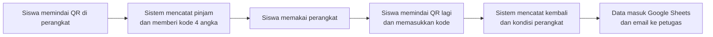

### 1.4 Tujuan dan indikator keberhasilan
| Tujuan | Indikator |
|---|---|
| Peminjaman tertib dan terdokumentasi | Seluruh transaksi tercatat |
| Akuntabilitas aset | Berkurangnya perangkat yang tidak diketahui peminjamnya |
| Efisiensi administrasi | Waktu pencatatan dan rekap lebih singkat |
| Pemantauan kondisi | Tersedia riwayat kondisi saat pinjam dan kembali |

### 1.5 Ruang lingkup
Termasuk: pencatatan peminjaman dan pengembalian, dashboard petugas, label QR, sinkron Google Sheets, notifikasi email, pengarsipan data.
Tidak termasuk: pelacakan lokasi perangkat, pemblokiran perangkat dari jarak jauh, pengelolaan aset selain laptop dan tablet, dan sistem tap tanpa kamera (butuh NFC).

---

## 2. Aktor dan hak akses

| Aktor | Peran | Cara masuk | Hak |
|---|---|---|---|
| **Siswa / peminjam** | Meminjam dan mengembalikan perangkat | Tanpa akun; memindai QR | Melihat status perangkat, meminjam, mengembalikan dengan kode |
| **Petugas sarpras** | Mengelola perangkat dan memantau | PIN petugas | Seluruh fitur dashboard |
| **Cron / sistem terjadwal** | Memicu pengecekan berkala | Kunci pada alamat `sync.php` | Sinkron, cek keterlambatan, kirim antrean email |
| **Google (Sheets dan Gmail)** | Sistem eksternal | Webhook dengan kata rahasia | Menerima data dan mengirim email |

---

## 3. Panduan singkat penggunaan

### 3.1 Untuk siswa
1. Pindai QR di perangkat dengan kamera HP. Halaman terbuka otomatis.
2. Isi nama dan kelas (atau NIS bila diwajibkan), pilih lama pinjam, tekan **Pinjam**.
3. **Catat kode 4 angka** yang muncul. Kode ini dibutuhkan saat mengembalikan.
4. Saat selesai, pindai QR yang sama, masukkan kode, pilih kondisi perangkat, tekan **Kembalikan**.
5. Kode hilang? Datangi petugas.

### 3.2 Untuk petugas
1. Buka halaman petugas, masuk dengan PIN.
2. **Tambah** perangkat, lalu **Label QR** untuk mencetak dan menempel.
3. Pantau di **Ringkasan**, **Perangkat**, dan **Riwayat**.
4. Perangkat berstatus **Perlu diperiksa**: periksa fisiknya, pilih kondisi terbaru, tandai sudah diperiksa.

### 3.3 Pertanyaan yang sering muncul
| Pertanyaan | Jawaban |
|---|---|
| Mengapa perlu kode 4 angka? | QR menempel di perangkat dan bisa dipindai siapa saja. Kode memastikan hanya peminjam yang bisa mengembalikan lewat QR. |
| Kode hilang? | Petugas mengembalikan dari dashboard (butuh PIN petugas). |
| Salah memasukkan kode? | Setelah 5 kali salah, kode terkunci dan harus lewat petugas. |
| Apa arti "Perlu diperiksa"? | Perangkat dikembalikan dalam kondisi tidak baik, atau baru didaftarkan dengan kondisi tidak baik. Tidak bisa dipinjam sampai petugas memeriksanya. |
| Jika Google Sheets sedang gangguan? | Pencatatan tetap berjalan; data menyusul pada sinkron berikutnya. |
| Jika Google Sheet dihapus atau diganti? | Data utama ada di database server, jadi tidak hilang. Sheet baru terisi penuh setelah **Kirim sekarang**. |

---

## 4. Kebutuhan sistem

### 4.1 Kebutuhan fungsional
| Kode | Kebutuhan |
|---|---|
| FR-01 | Sistem mengidentifikasi perangkat dari QR (parameter `id`) dan menampilkan statusnya. |
| FR-02 | Siswa dapat meminjam perangkat berstatus Tersedia pada jam layanan dengan lama pinjam per jam. |
| FR-03 | Sistem menerbitkan kode pengembalian 4 angka saat peminjaman berhasil. |
| FR-04 | Siswa dapat mengembalikan perangkat dengan kode dan melaporkan kondisinya. |
| FR-05 | Petugas dapat mengembalikan perangkat atas nama peminjam tanpa kode. |
| FR-06 | Petugas dapat mendaftarkan, menghapus, dan mengarsipkan perangkat. |
| FR-07 | Petugas dapat memeriksa perangkat berstatus Perlu diperiksa dan menetapkan kondisi barunya. |
| FR-08 | Dashboard menampilkan ringkasan status, indikator 30 hari, daftar perangkat, dan riwayat yang dapat dicari. |
| FR-09 | Petugas dapat mencetak label QR. |
| FR-10 | Petugas dapat menghapus riwayat (satuan atau berdasarkan umur) dengan arsip ke Google Sheets. |
| FR-11 | Data disalin ke Google Sheets setiap ada perubahan. |
| FR-12 | Petugas menerima email setiap pengembalian, dengan isi menyesuaikan kondisi, serta email keterlambatan. |
| FR-13 | Verifikasi NIS terhadap daftar siswa (opsional). |

### 4.2 Kebutuhan non-fungsional
| Kode | Kebutuhan | Cara dipenuhi |
|---|---|---|
| NFR-01 | Tidak boleh ada dua peminjam aktif pada satu perangkat | Indeks unik database dan transaksi `BEGIN IMMEDIATE` |
| NFR-02 | Pencatatan tidak bergantung pada Google | Database lokal sebagai sumber data; Sheets hanya salinan |
| NFR-03 | Mudah dipasang di hosting sekolah | PHP + SQLite, tanpa Composer dan tanpa server khusus |
| NFR-04 | Mudah dipakai di HP | Antarmuka responsif, tanpa instalasi aplikasi |
| NFR-05 | Data sensitif terlindungi | PIN, pembatasan percobaan, folder internal dikunci, HTTPS |
| NFR-06 | Tahan terhadap kegagalan sementara | Antrean email dan penanda sinkron dengan percobaan ulang |
| NFR-07 | Berkelanjutan setelah PLP | Akun dan hosting milik sekolah, dokumentasi, dan cadangan data |

---

## 5. Use case diagram

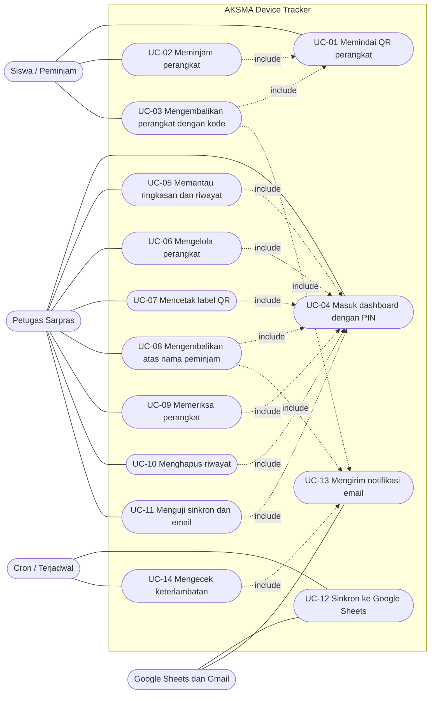

### 5.1 Spesifikasi use case utama

**UC-02 Meminjam perangkat**
| Elemen | Isi |
|---|---|
| Aktor | Siswa |
| Prasyarat | QR perangkat terpindai; perangkat berstatus Tersedia; saat ini dalam jam layanan |
| Alur utama | 1. Sistem menampilkan data perangkat dan pilihan lama pinjam. 2. Siswa mengisi identitas dan memilih lama pinjam. 3. Sistem memvalidasi data. 4. Sistem mencatat transaksi dan menghasilkan kode 4 angka. 5. Sistem menampilkan kode dan batas waktu kembali. |
| Alur alternatif | Di luar jam layanan: ditolak dengan pesan jam layanan. Perangkat tidak tersedia: formulir tidak muncul. Siswa masih meminjam perangkat lain: ditolak. NIS tidak terdaftar atau nama tidak cocok: ditolak. Perangkat baru saja dipinjam orang lain: ditolak. |
| Pascakondisi | Transaksi aktif tercatat; status perangkat Dipinjam; data tersinkron ke Google Sheets |

**UC-03 Mengembalikan perangkat dengan kode**
| Elemen | Isi |
|---|---|
| Aktor | Siswa; Google (penerima email) |
| Prasyarat | Perangkat berstatus Dipinjam atau Terlambat; siswa memiliki kode 4 angka |
| Alur utama | 1. Siswa memindai QR; sistem menampilkan formulir pengembalian. 2. Siswa memasukkan kode, memilih kondisi, dan mengisi catatan (opsional). 3. Sistem mencocokkan kode. 4. Sistem menutup transaksi dan memperbarui kondisi perangkat. 5. Sistem mengantrekan email untuk petugas. |
| Alur alternatif | Kode salah: hitungan percobaan bertambah dan sisa percobaan ditampilkan. Salah 5 kali: kode terkunci, harus lewat petugas. Kondisi bukan Baik: status perangkat menjadi Perlu diperiksa. |
| Pascakondisi | Transaksi ditutup; status Tersedia (kondisi Baik) atau Perlu diperiksa; email terkirim |

**UC-10 Menghapus riwayat**
| Elemen | Isi |
|---|---|
| Aktor | Petugas |
| Prasyarat | Sudah masuk dashboard; catatan sudah dikembalikan |
| Alur utama | 1. Petugas memilih Hapus pada catatan, atau Hapus riwayat lama dengan batas umur. 2. Sistem meminta konfirmasi. 3. Sistem menyalin catatan ke tab arsip Google Sheets. 4. Setelah sukses, sistem menghapus catatan dari database. |
| Alur alternatif | Penyalinan arsip gagal: tidak ada yang dihapus. Arsip dimatikan: catatan dihapus permanen setelah peringatan. |
| Pascakondisi | Catatan hilang dari dashboard dan tab transaksi; salinan ada di tab arsip |

---

## 6. Activity diagram

### 6.1 Peminjaman perangkat

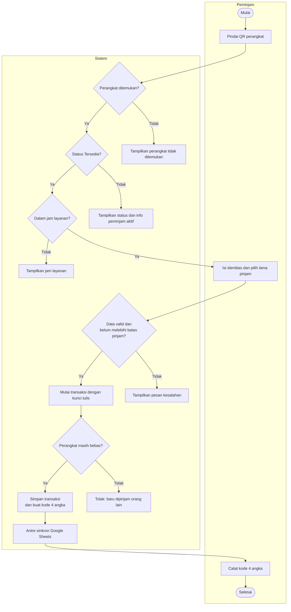

### 6.2 Pengembalian oleh peminjam

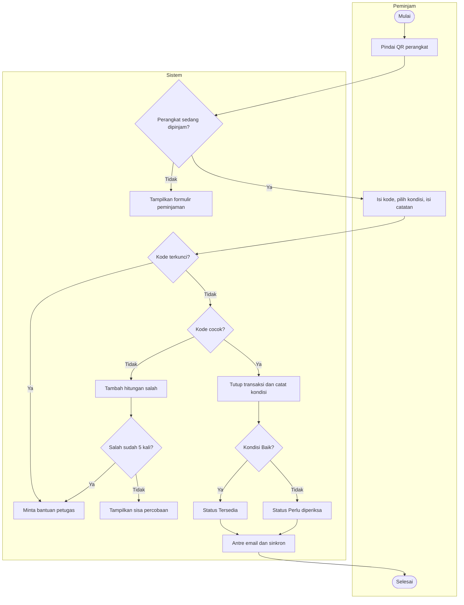

### 6.3 Pemeriksaan perangkat oleh petugas

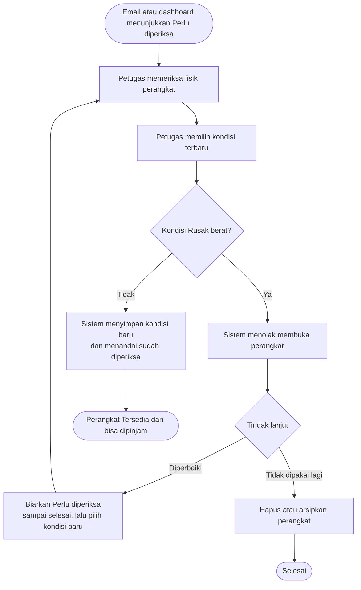

### 6.4 Penghapusan riwayat dengan arsip

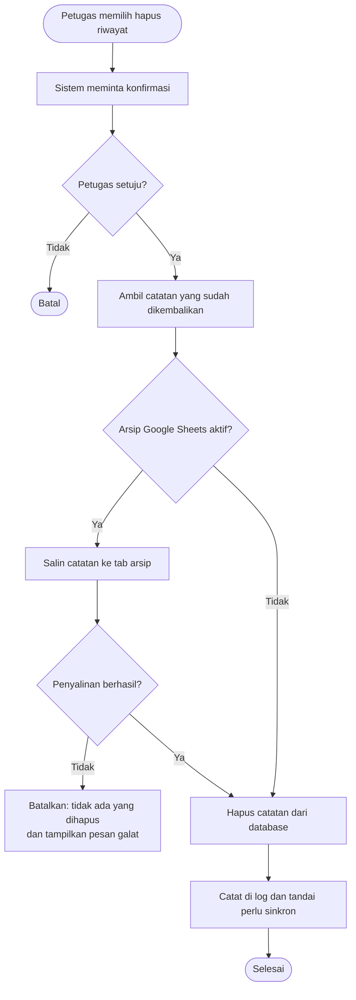

### 6.5 Proses latar: sinkron dan notifikasi
Dijalankan setelah jawaban dikirim ke pengguna, sehingga pengguna tidak menunggu Google.

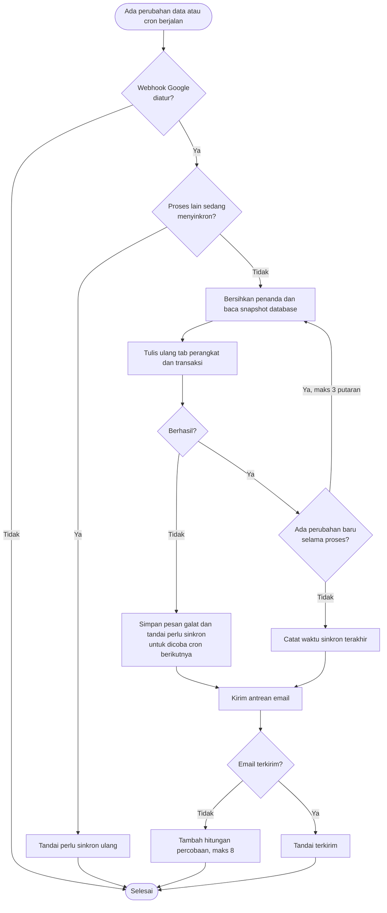

### 6.6 Pengecekan keterlambatan

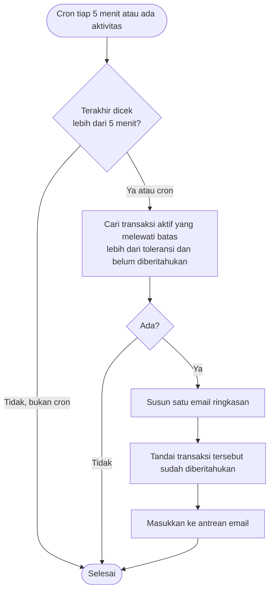

---

## 7. Status perangkat (state diagram)

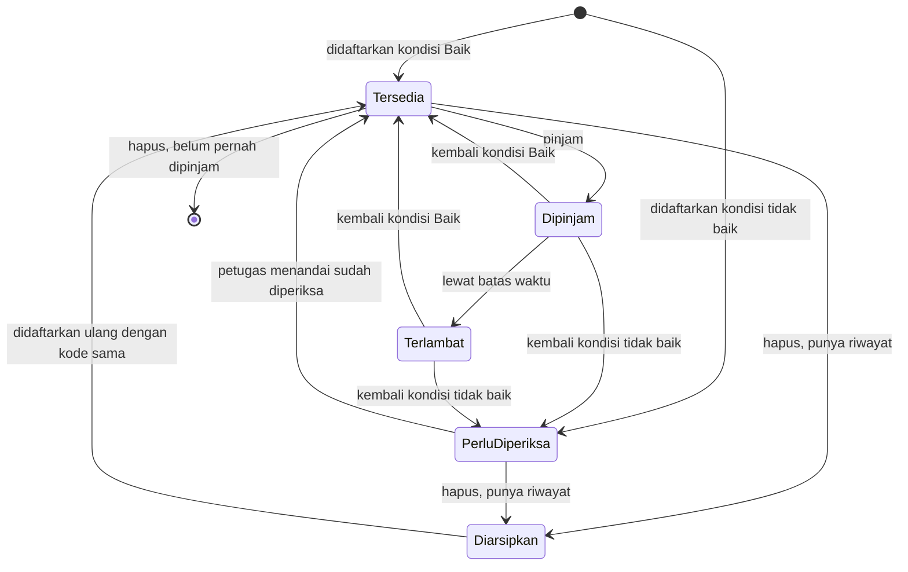

Catatan:
- **Terlambat tidak disimpan**, melainkan dihitung dari waktu sekarang terhadap batas kembali. Karena itu selalu akurat.
- Perangkat berkondisi **Rusak berat** tidak bisa dipindahkan ke Tersedia sebelum kondisinya diubah.
- Perangkat yang sedang Dipinjam atau Terlambat tidak dapat dihapus.

---

## 8. Sequence diagram

### 8.1 Peminjaman

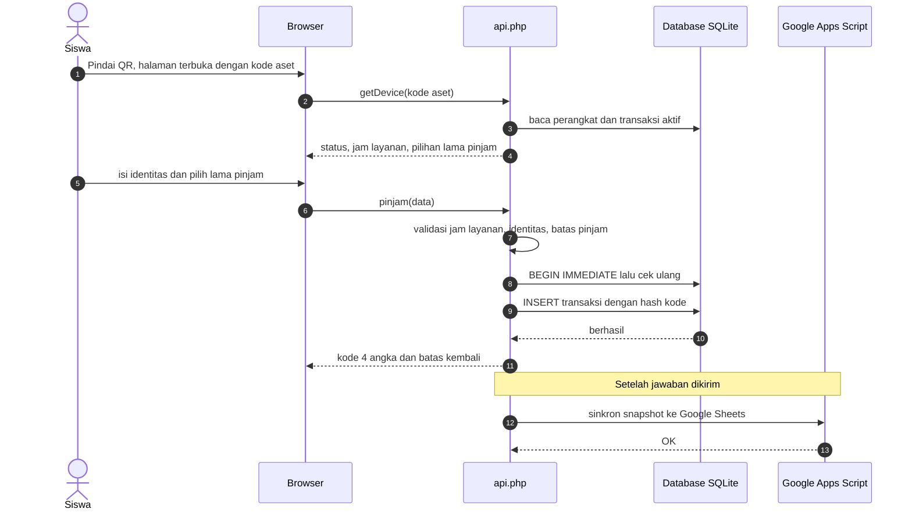

### 8.2 Pengembalian dan notifikasi

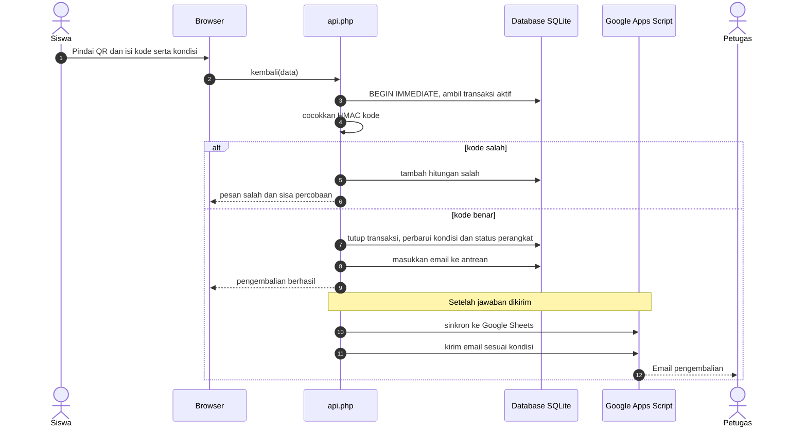

---

## 9. Arsitektur dan deployment

### 9.1 Arsitektur logis

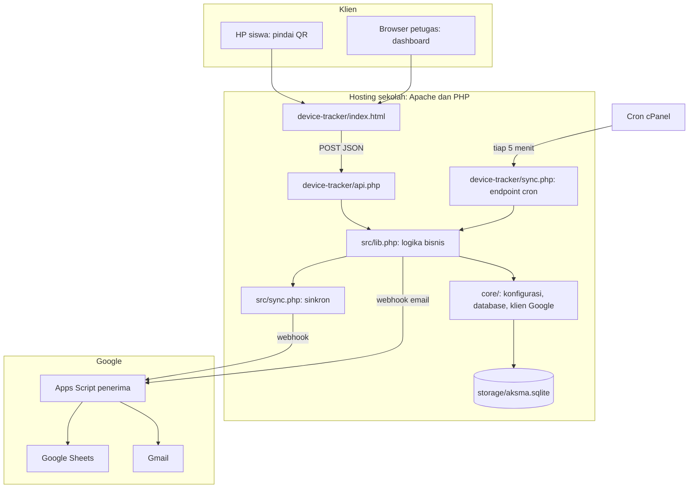

### 9.2 Prinsip rancangan
| Prinsip | Penjelasan |
|---|---|
| Database sebagai sumber kebenaran | Google Sheets hanyalah salinan; sinkron selalu menulis ulang snapshot penuh, sehingga idempoten. |
| Logika di server | Semua validasi ada di PHP; frontend hanya menampilkan. |
| Kerja berat setelah respons | Sinkron dan email dijalankan setelah jawaban dikirim. |
| Modular | Folder `core/` dipakai bersama; tiap modul punya prefix tabel sendiri. |

### 9.3 Struktur folder
```
index.php                  Portal AKSMA DIGITAL HUB
core/                      Konfigurasi, database, klien Google (dipakai semua modul)
storage/                   Database, kunci, log (tidak di-commit)
google-sheets/penerima.gs  Kode Apps Script penerima
device-tracker/
  index.html               Antarmuka
  api.php                  Pintu masuk API
  sync.php                 Endpoint cron
  module.json              Metadata modul
  src/lib.php              Logika bisnis
  src/sync.php             Sinkron ke Google Sheets
  tools/import_siswa.php   Impor daftar siswa
docs/DOKUMENTASI.md        Dokumen ini
```

---

## 10. Perancangan data (ERD dan kamus data)

### 10.1 ERD

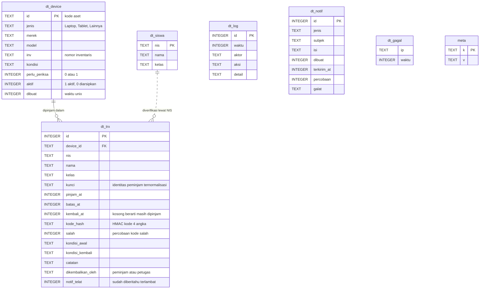

Hubungan `dt_siswa` ke `dt_trx` bersifat logis (lewat NIS saat verifikasi diaktifkan), bukan kunci asing.

### 10.2 Kamus data (kolom penting)
| Tabel.kolom | Keterangan |
|---|---|
| `dt_device.id` | Kode aset unik. Huruf besar, angka, `-` atau `_`, panjang 2 sampai 40. |
| `dt_device.perlu_periksa` | 1 bila menunggu pemeriksaan petugas; perangkat tidak bisa dipinjam. |
| `dt_device.aktif` | 0 = diarsipkan (hilang dari daftar, riwayat tetap). |
| `dt_trx.kunci` | `nis:<NIS>` bila verifikasi NIS aktif, atau `nm:<nama>\|<kelas>` yang dinormalkan. Dipakai untuk membatasi pinjam per orang. |
| `dt_trx.kembali_at` | `NULL` = transaksi aktif. Indeks unik parsial menjamin hanya satu transaksi aktif per perangkat. |
| `dt_trx.kode_hash` | HMAC-SHA256 dari kode, kode aset, dan waktu pinjam. Kode asli tidak disimpan. |
| `dt_notif.percobaan` | Jumlah upaya kirim; berhenti di 8. |
| `meta` | Penanda internal: `dt.dirty` (perlu sinkron), `dt.sync_ok`, `dt.sync_err`, `dt.cek_at`. |

### 10.3 Tab Google Sheets
| Tab | Perilaku | Isi |
|---|---|---|
| `DT_Perangkat` | Ditulis ulang tiap sinkron | Kode aset, jenis, merek, model, inventaris, kondisi, status, peminjam, kelas, waktu |
| `DT_Transaksi` | Ditulis ulang tiap sinkron | Seluruh transaksi, terbaru di atas |
| `DT_Arsip` | Hanya bertambah | Catatan riwayat yang dihapus |

Mengedit manual `DT_Perangkat` dan `DT_Transaksi` tidak disarankan karena akan tertimpa sinkron berikutnya.

---

## 11. Aturan bisnis, API, dan keamanan

### 11.1 Aturan bisnis
| Kode | Aturan |
|---|---|
| BR-01 | Peminjaman hanya pada jam layanan per hari (default Senin sampai Jumat 07.00 sampai 16.00). |
| BR-02 | Lama pinjam dipilih per jam (default 1 sampai 4 jam) dan batas kembali tidak boleh melewati jam tutup. |
| BR-03 | Bila sisa waktu kurang dari 1 jam dan minimal 30 menit, tersedia pilihan "sampai jam tutup". |
| BR-04 | Satu perangkat hanya boleh memiliki satu transaksi aktif. |
| BR-05 | Satu peminjam maksimal meminjam sejumlah perangkat yang ditetapkan (default 1) pada saat yang sama. |
| BR-06 | Nama minimal 3 karakter; kelas wajib bila verifikasi NIS tidak aktif. |
| BR-07 | Bila verifikasi NIS aktif, NIS harus terdaftar dan nama harus sesuai; kelas diambil dari data siswa. |
| BR-08 | Peminjaman dapat diwajibkan didampingi petugas (PIN) lewat pengaturan. |
| BR-09 | Kode pengembalian terdiri dari 4 angka acak; setelah 5 kali salah, terkunci. |
| BR-10 | Pengembalian dengan kondisi bukan Baik menjadikan perangkat Perlu diperiksa. |
| BR-11 | Perangkat Perlu diperiksa tidak dapat dipinjam. Perangkat berkondisi Rusak berat tidak dapat dibuka sebelum kondisinya diubah. |
| BR-12 | Status Terlambat dihitung dari waktu sekarang dan batas kembali. |
| BR-13 | Setiap pengembalian dikabari lewat email; isi menyesuaikan kondisi (Baik, tidak baik, rusak berat) dan ketepatan waktu. |
| BR-14 | Keterlambatan dikabari sekali per transaksi, setelah toleransi (default 10 menit), dalam satu email ringkasan. |
| BR-15 | Hanya catatan yang sudah dikembalikan yang dapat dihapus. Bila arsip aktif, penyalinan harus sukses sebelum penghapusan. |
| BR-16 | Perangkat yang belum pernah dipinjam dihapus permanen; yang punya riwayat diarsipkan. Perangkat yang sedang dipinjam tidak dapat dihapus. |
| BR-17 | PIN petugas salah 5 kali dari IP yang sama dalam 10 menit memblokir percobaan berikutnya selama itu. |

### 11.2 API internal
`POST device-tracker/api.php` dengan body `{"fn": "<nama>", "args": [...]}` dan header `X-Requested-With: aksma`. Jawaban `{"ok": true, "data": ...}` atau `{"ok": false, "error": "..."}`.

| Fungsi | Akses | Fungsi |
|---|---|---|
| `getDevice` | Publik | Info perangkat, jam layanan, pilihan lama pinjam |
| `pinjam` | Publik | Membuat transaksi dan kode |
| `kembali` | Publik (kode) | Menutup transaksi |
| `adminData` | PIN | Data dashboard |
| `adminAddDevice` | PIN | Mendaftarkan atau mengaktifkan ulang perangkat |
| `adminTandaiDiperiksa` | PIN | Menetapkan kondisi dan membuka perangkat |
| `adminKembalikan` | PIN | Pengembalian oleh petugas |
| `adminHapusPerangkat` | PIN | Hapus atau arsipkan perangkat |
| `adminHapusRiwayat`, `adminHapusRiwayatLama` | PIN | Hapus riwayat (maks 300 per permintaan atau 2.000 per penghapusan lama) |
| `adminSyncSekarang`, `adminTesNotif` | PIN | Uji sinkron dan email |

### 11.3 Keamanan
| Ancaman | Penanganan |
|---|---|
| Orang iseng menandai perangkat "kembali" | Wajib kode 4 angka (disimpan sebagai HMAC) dengan batas 5 percobaan |
| Menebak PIN petugas | Pembatasan percobaan per IP; PIN dapat disimpan sebagai hash bcrypt |
| Permintaan lintas situs | API hanya menerima POST berheader kustom |
| Dua pengguna bersamaan | Indeks unik database dan transaksi dengan kunci tulis |
| Berkas internal terbuka dari web | `.htaccess` pada `core/`, `storage/`, `src/`, `tools/` |
| Penyalahgunaan webhook Google | Kata rahasia pada setiap permintaan |
| Kebocoran rahasia di repositori | `config.php` dan `storage/` masuk `.gitignore`; hanya `config.example.php` yang di-commit |
| Data pribadi siswa | Akses Google Sheet dibatasi; gunakan akun Google sekolah |

---

## 12. Skenario pengujian
Skenario uji manual. Kolom "Hasil" diisi saat pengujian di lingkungan sekolah.

| ID | Skenario | Langkah ringkas | Hasil yang diharapkan | Aturan | Hasil |
|---|---|---|---|---|---|
| TC-01 | Pinjam normal | Pindai QR, isi data, pilih 2 jam | Kode 4 angka tampil; status Dipinjam; baris masuk Sheet | FR-02, FR-03 | ☐ |
| TC-02 | Di luar jam layanan | Pinjam setelah jam tutup | Ditolak, jam layanan ditampilkan | BR-01 | ☐ |
| TC-03 | Sisa waktu kurang dari 1 jam | Pinjam pukul 15.20 | Hanya pilihan "sampai jam tutup" | BR-03 | ☐ |
| TC-04 | Dua orang pindai bersamaan | Dua HP kirim pinjam bersamaan | Satu berhasil, satu ditolak | BR-04 | ☐ |
| TC-05 | Pinjam kedua oleh orang sama | Pinjam perangkat lain saat belum kembali | Ditolak | BR-05 | ☐ |
| TC-06 | Verifikasi NIS | NIS tidak terdaftar atau nama tidak cocok | Ditolak | BR-07 | ☐ |
| TC-07 | Kode salah | Masukkan kode salah satu kali | Pesan salah dan sisa percobaan | BR-09 | ☐ |
| TC-08 | Kode salah 5 kali | Salah lima kali berturut-turut | Kode terkunci | BR-09 | ☐ |
| TC-09 | Kembali kondisi Baik | Kode benar, kondisi Baik | Status Tersedia; email "dikembalikan (kondisi baik)" | BR-13 | ☐ |
| TC-10 | Kembali kondisi lecet | Kode benar, kondisi Ada lecet | Status Perlu diperiksa; email peringatan | BR-10, BR-13 | ☐ |
| TC-11 | Kembali rusak berat | Kondisi Rusak berat | Email bertanda PERLU TINDAKAN | BR-13 | ☐ |
| TC-12 | Pinjam saat Perlu diperiksa | Pindai QR perangkat tersebut | Tidak bisa dipinjam | BR-11 | ☐ |
| TC-13 | Tandai rusak berat sebagai diperiksa | Pilih Rusak berat lalu tandai | Ditolak | BR-11 | ☐ |
| TC-14 | Keterlambatan | Biarkan lewat batas plus toleransi | Satu email ringkasan, tidak berulang | BR-14 | ☐ |
| TC-15 | Pengembalian oleh petugas | Kembalikan dari dashboard tanpa kode | Berhasil; tercatat "petugas" | FR-05 | ☐ |
| TC-16 | PIN salah 5 kali | Salah PIN lima kali | Diblokir sementara | BR-17 | ☐ |
| TC-17 | Sinkron Sheets | Tekan Kirim sekarang | Tab terisi sesuai database | FR-11 | ☐ |
| TC-18 | Google gagal | Matikan akses sementara, lakukan pinjam | Pinjam tetap berhasil; sinkron menyusul | NFR-02 | ☐ |
| TC-19 | Hapus riwayat | Hapus catatan | Hilang dari dashboard; salinan di DT_Arsip | BR-15 | ☐ |
| TC-20 | Hapus saat arsip gagal | Arsip tidak dapat dijangkau | Tidak ada yang terhapus; pesan galat | BR-15 | ☐ |
| TC-21 | Hapus perangkat dipinjam | Hapus perangkat berstatus Dipinjam | Ditolak | BR-16 | ☐ |
| TC-22 | Hapus perangkat berriwayat | Hapus perangkat yang pernah dipinjam | Diarsipkan, riwayat tetap | BR-16 | ☐ |
| TC-23 | Permintaan tanpa header | Kirim ke API tanpa header kustom | Ditolak (403) | NFR-05 | ☐ |
| TC-24 | Kode aset tidak dikenal | Buka `?id=XXXX` yang tidak ada | Pesan perangkat tidak ditemukan | FR-01 | ☐ |

---

## 13. Batasan dan pengembangan lanjutan

### 13.1 Batasan saat ini
- Sistem memastikan pengembali memiliki kode yang benar, **bukan** bahwa perangkat sudah fisik di tangan petugas.
- Satu PIN bersama untuk semua petugas; belum ada akun per petugas.
- Gambar QR dibuat lewat layanan eksternal sehingga butuh internet saat mencetak label.
- Belum ada pengujian otomatis; pengujian dilakukan manual (bagian 12).
- Kuota email Gmail sekitar 100 per hari.
- Satu server dan satu berkas database; cadangan dilakukan dengan mengunduh `aksma.sqlite`.

### 13.2 Ide pengembangan
| Ide | Manfaat |
|---|---|
| Konfirmasi pengembalian oleh petugas | Memastikan perangkat fisik diperiksa sebelum dinyatakan kembali |
| Notifikasi Telegram | Cepat terlihat di HP, tanpa kuota email ketat |
| Ringkasan harian | Mengurangi jumlah email |
| Pembuatan QR lokal | Tidak bergantung internet saat mencetak |
| Akun petugas terpisah | Jejak audit per orang |
| Ekspor laporan bulanan | Bahan evaluasi sekolah |
| Integrasi dengan GREEN INFO dan GREEN HUB | Satu portal AKSMA DIGITAL HUB |

---

## 14. Glosarium
| Istilah | Arti |
|---|---|
| **QR Code** | Kode gambar yang dibaca kamera HP dan membuka alamat web tertentu |
| **Dashboard** | Halaman pemantauan untuk petugas |
| **Aset / kode aset** | Perangkat sekolah dan kode uniknya, misalnya `LAP-001` |
| **Transaksi** | Satu catatan peminjaman, dari pinjam sampai kembali |
| **Snapshot** | Salinan penuh data pada satu waktu |
| **Idempoten** | Dijalankan berkali-kali tetap menghasilkan hasil yang sama |
| **Webhook** | Alamat web yang menerima kiriman data dari sistem lain |
| **Apps Script** | Layanan Google untuk menjalankan kode kecil terhubung ke Sheets dan Gmail |
| **Cron** | Penjadwal tugas otomatis pada hosting |
| **HMAC** | Cara membuat sidik jari data dengan kunci rahasia, sehingga kode tidak disimpan apa adanya |
| **SQLite** | Database berupa satu berkas, tanpa server terpisah |
| **ERD** | Diagram hubungan antartabel data |
| **Use case** | Daftar hal yang bisa dilakukan pengguna terhadap sistem |
| **Activity diagram** | Diagram alur langkah suatu proses |
